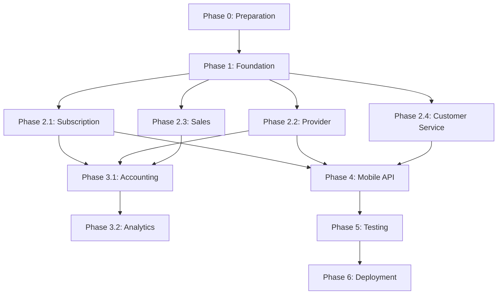

# خطة إعادة الهيكلة الشاملة - نظام إدارة التأمين الصحي

## 📋 المحتويات

1. [تدقيق الوضع الحالي](#1-تدقيق-الوضع-الحالي)
2. [البنية المستهدفة](#2-البنية-المستهدفة)
3. [تخطيط الموديلات من الحالي إلى المستهدف](#3-تخطيط-الموديلات-من-الحالي-إلى-المستهدف)
4. [خريطة الطريق التدريجية](#4-خريطة-الطريق-التدريجية)
5. [استراتيجية الاختبار](#5-استراتيجية-الاختبار)
6. [المخاطر وخطط التراجع](#6-المخاطر-وخطط-التراجع)

---

## 1. تدقيق الوضع الحالي

### 1.1 البنية المعمارية الحالية

**التقنيات المستخدمة:**
- Laravel 9 (PHP 8.0+)
- Inertia.js + Vue 3
- MySQL Database
- Laravel Sanctum + JWT Auth (تكرار في المصادقة)
- scottlaurent/accounting (محاسبة مزدوجة القيد)
- QiPay للدفع الإلكتروني
- WhatsApp Integration (Jobs/Queue)
- Simple QRCode

**البنية الحالية:**
```
app/
├── Http/Controllers/
│   ├── Api/CardsController.php (الكروت والخدمات)
│   ├── HospitalController.php (المواعيد)
│   ├── PaymentController.php (الدفع)
│   ├── AccountingController.php (الحسابات)
│   ├── UserController.php (المستخدمين)
│   ├── PhoneController.php (الهاتف/WhatsApp)
│   └── ImportController.php (استيراد البيانات)
├── Models/
│   ├── Card.php (بطاقات الاشتراك)
│   ├── CardService.php (خدمات البطاقات)
│   ├── Profile.php (ملفات المشتركين)
│   ├── User.php (المستخدمون)
│   ├── UserType.php (أنواع المستخدمين)
│   ├── Appointment.php (المواعيد)
│   ├── Order.php (الطلبات)
│   ├── Wallet.php (المحفظة)
│   ├── Transactions.php (المعاملات المالية)
│   ├── AccountingJournal*.php (المحاسبة)
│   ├── Category.php (التصنيفات)
│   ├── PendingRequest.php (الطلبات المعلقة)
│   ├── DoctorResults.php (نتائج الأطباء)
│   └── Results.php (النتائج)
└── Jobs/
    └── SendWhatsAppMessageJob.php (رسائل واتساب)
```

### 1.2 الموديلات والبيانات الموجودة

#### الموديلات القابلة لإعادة الاستخدام:
1. **Card** - بطاقات الاشتراك (اسم عربي/انجليزي، سعر، مدة، صلاحية)
2. **CardService** - خدمات البطاقات (مزود الخدمة، السعر، أوقات العمل، عدد المواعيد)
3. **Profile** - ملفات المشتركين (الاسم، رقم البطاقة، الهاتف، العنوان، أفراد العائلة)
4. **User** - المستخدمون (admin, data_entry, seles, doctor, account, hospital, mobile)
5. **Appointment** - المواعيد (المشترك، مزود الخدمة، التاريخ، الحضور)
6. **Order** - طلبات الدفع (QiPay integration)
7. **Wallet + Transactions** - نظام المحافظ والمعاملات المالية
8. **Accounting*** - نظام المحاسبة المزدوجة (scottlaurent/accounting)
9. **Category** - تصنيفات الخدمات (parent/child hierarchy)
10. **PendingRequest** - طلبات البطاقات المعلقة

#### الموديلات التي تحتاج إعادة تصميم:
- **DoctorResults/Results** → دمجها في `Visit` (كشفيات الأطباء)
- **ExtractedPhone/DataCv** → نقلها خارج نطاق النظام (مخصصة لحملات WhatsApp)
- **WheelResult/WheelItem** → إزالة (ميزة العجلة غير ذات صلة بالتأمين)
- **Message/MessageLog** → استبدالها بـ `Ticket` System

### 1.3 المصادقة والأدوار

**المشاكل الحالية:**
1. **تداخل المصادقة:** استخدام Sanctum + JWT معاً
2. **UserType في جدول منفصل:** يجب استخدام Laravel Permissions/Roles
3. **صلاحيات غير واضحة:** لا توجد Policies واضحة

**الأدوار الموجودة:**
- `admin` - المدير
- `data_entry` - مدخل البيانات
- `seles` - مندوب المبيعات
- `doctor` - الطبيب/مزود الخدمة
- `account` - المحاسب
- `hospital` - المستشفى
- `mobile` - مستخدم التطبيق

### 1.4 Routes والـ API

**المشاكل:**
1. **Routes غير منظم:** خلط بين web و api routes
2. **تسمية غير متسقة:** استخدام أسماء عربية في بعض الـ routes
3. **نقاط النهاية مفتوحة:** بعض الـ endpoints بدون حماية
4. **عدم وجود API Versioning:** `/api/v1` موجود جزئياً فقط

### 1.5 الديون التقنية والمخاطر

#### ⚠️ **المخاطر الحرجة:**

1. **ملفات PHP في الجذر:**
   - `import_from_access.php` - استيراد من Access Database (يتطلب ODBC Driver)
   - `import_data_cv.php` - استيراد ملفات CSV
   - `test-import-address.php` - ملف تجريبي
   - **الخطر:** تنفيذ مباشر من المتصفح، لا يمر عبر Laravel security

2. **لا يوجد ملف `.env` في Git:** ✅ جيد (لكن تحقق من `.env.example`)

3. **منطق عمل في Controllers:**
   - `AccountingController`: أكثر من 380 سطر
   - `CardsController`: أكثر من 640 سطر
   - **المشكلة:** يجب نقل المنطق إلى Services

4. **عدم وجود اختبارات:**
   - لا توجد ملفات في `tests/`
   - **الخطر الأكبر:** صعوبة Refactoring بأمان

5. **Validation ضعيف:**
   - بعض الـ endpoints بدون validation
   - لا يوجد Form Requests في جميع الحالات

6. **تكرار الاستعلامات:**
   - استعلامات مكررة في Controllers
   - لا يوجد Repository Pattern

7. **الترجمة غير مكتملة:**
   - Arabic/English في قاعدة البيانات
   - لكن ملفات اللغة في `lang/` أساسية فقط

8. **WhatsApp Integration:**
   - Jobs موجودة لكن غير مرتبطة بالنظام الرئيسي
   - `ExtractedPhone`, `DataCv` تبدو كميزة منفصلة لحملات التسويق

### 1.6 نقاط القوة

✅ **ما يعمل جيداً:**
1. **نظام المحاسبة:** استخدام `scottlaurent/accounting` - محاسبة مزدوجة قياسية
2. **QRCode:** integration جاهز للبطاقات الرقمية
3. **Multi-language:** دعم العربية والإنجليزية في Models
4. **Payment Gateway:** QiPay integration موجود
5. **Queue System:** Laravel Jobs جاهز للعمليات الثقيلة
6. **Database Structure:** جداول منظمة بشكل معقول
7. **Soft Deletes:** مستخدم في `User` و `Transactions`

---

## 2. البنية المستهدفة

### 2.1 هيكل النظام الجديد (Modular Architecture)

```
app/
├── Modules/                          # النظام المعياري
│   ├── Subscription/                 # وحدة الاشتراكات
│   │   ├── Models/
│   │   │   ├── Subscription.php     # الاشتراك الرئيسي
│   │   │   ├── SubscriptionType.php  # أنواع الاشتراكات
│   │   │   ├── Member.php            # أعضاء الاشتراك
│   │   │   └── Document.php          # المستندات
│   │   ├── Services/
│   │   │   ├── SubscriptionService.php
│   │   │   └── RenewalService.php
│   │   ├── Http/
│   │   │   ├── Controllers/
│   │   │   ├── Requests/
│   │   │   └── Resources/
│   │   ├── Policies/
│   │   └── Database/
│   │       └── Migrations/
│   │
│   ├── Provider/                     # وحدة شبكة الأطباء
│   │   ├── Models/
│   │   │   ├── Provider.php         # مزود الخدمة
│   │   │   ├── ProviderService.php   # الخدمات المتاحة
│   │   │   ├── Contract.php          # عقود الأطباء
│   │   │   └── Visit.php             # الكشفيات
│   │   ├── Services/
│   │   │   ├── ProviderService.php
│   │   │   ├── CoverageVerificationService.php
│   │   │   └── VisitRecordingService.php
│   │   └── ...
│   │
│   ├── Sales/                        # وحدة المبيعات
│   │   ├── Models/
│   │   │   ├── SalesRep.php          # المندوب
│   │   │   ├── Commission.php        # العمولات
│   │   │   ├── Target.php            # الأهداف
│   │   │   └── Sale.php              # عملية البيع
│   │   ├── Services/
│   │   │   ├── SalesService.php
│   │   │   └── CommissionCalculationService.php
│   │   └── ...
│   │
│   ├── CustomerService/              # وحدة خدمة العملاء
│   │   ├── Models/
│   │   │   ├── Ticket.php            # التذاكر
│   │   │   ├── TicketMessage.php     # رسائل التذكرة
│   │   │   └── TicketCategory.php    # أنواع الطلبات
│   │   ├── Services/
│   │   │   └── TicketService.php
│   │   └── ...
│   │
│   ├── Accounting/                   # وحدة الحسابات
│   │   ├── Models/
│   │   │   ├── Invoice.php           # الفواتير
│   │   │   ├── Payment.php           # المدفوعات
│   │   │   └── ProviderDue.php       # مستحقات الأطباء
│   │   ├── Services/
│   │   │   ├── InvoiceService.php
│   │   │   ├── PaymentService.php
│   │   │   └── DoubleEntryService.php
│   │   └── ...
│   │
│   └── Analytics/                    # وحدة التحليلات
│       ├── Services/
│       │   ├── AnalyticsService.php
│       │   ├── CostAnalysisService.php
│       │   └── ReportGenerationService.php
│       └── ...
│
├── Domain/                           # Shared Domain Logic
│   ├── User/
│   ├── Notification/
│   └── Payment/
│
└── Support/                          # Shared Helpers
    ├── Traits/
    ├── Helpers/
    └── Enums/
```

### 2.2 نموذج البيانات المستهدف (ERD)

```mermaid
erDiagram
    %% Subscription Module
    SUBSCRIPTION ||--o{ SUBSCRIPTION_MEMBER : contains
    SUBSCRIPTION ||--|| SUBSCRIPTION_TYPE : has
    SUBSCRIPTION ||--o{ DOCUMENT : has
    SUBSCRIPTION ||--o{ RENEWAL_HISTORY : tracks
    SUBSCRIPTION }o--|| USER : belongs_to
    
    SUBSCRIPTION {
        uuid id PK
        string subscription_number UK
        bigint subscription_type_id FK
        bigint subscriber_id FK
        date start_date
        date end_date
        string status "active,expired,cancelled"
        decimal amount
        timestamp created_at
        timestamp updated_at
    }
    
    SUBSCRIPTION_TYPE {
        bigint id PK
        string name_ar
        string name_en
        text description_ar
        text description_en
        integer duration_days
        decimal price
        integer max_members
        json covered_services
        boolean is_active
    }
    
    SUBSCRIPTION_MEMBER {
        uuid id PK
        uuid subscription_id FK
        string name
        string relation
        date birth_date
        string gender
        json medical_history
        timestamp created_at
    }
    
    %% Provider Module
    PROVIDER ||--o{ PROVIDER_SERVICE : offers
    PROVIDER ||--o{ CONTRACT : has
    PROVIDER ||--o{ VISIT : records
    PROVIDER_SERVICE }o--|| SERVICE_CATEGORY : belongs_to
    
    PROVIDER {
        bigint id PK
        string provider_code UK
        string name_ar
        string name_en
        string type "doctor,clinic,hospital,pharmacy"
        string specialty
        string phone
        string address
        json working_hours
        boolean is_contracted
        timestamp created_at
    }
    
    PROVIDER_SERVICE {
        bigint id PK
        bigint provider_id FK
        bigint service_category_id FK
        string service_name_ar
        string service_name_en
        decimal cost
        integer duration_minutes
        boolean is_active
    }
    
    VISIT {
        uuid id PK
        string visit_number UK
        uuid subscription_id FK
        bigint provider_id FK
        bigint service_id FK
        datetime visit_date
        text diagnosis
        decimal cost
        string status "pending,approved,rejected"
        bigint reviewed_by FK
        timestamp created_at
    }
    
    CONTRACT {
        bigint id PK
        bigint provider_id FK
        date start_date
        date end_date
        json terms
        decimal payment_terms
        string status
    }
    
    %% Sales Module
    SALES_REP ||--o{ SALE : makes
    SALES_REP ||--o{ COMMISSION : earns
    SALES_REP ||--o{ TARGET : has
    SALE ||--|| SUBSCRIPTION : creates
    
    SALES_REP {
        bigint id PK
        string rep_code UK
        string name
        string phone
        string email
        decimal commission_rate
        string region
        boolean is_active
        bigint user_id FK
    }
    
    SALE {
        uuid id PK
        bigint sales_rep_id FK
        uuid subscription_id FK
        date sale_date
        decimal amount
        decimal commission_amount
        string payment_method
        timestamp created_at
    }
    
    COMMISSION {
        uuid id PK
        bigint sales_rep_id FK
        uuid sale_id FK
        decimal amount
        date period_start
        date period_end
        string status "pending,paid"
        timestamp paid_at
    }
    
    TARGET {
        bigint id PK
        bigint sales_rep_id FK
        integer target_count
        decimal target_amount
        date period_start
        date period_end
    }
    
    %% Customer Service Module
    TICKET ||--o{ TICKET_MESSAGE : contains
    TICKET }o--|| TICKET_CATEGORY : categorized_by
    TICKET }o--|| USER : created_by
    TICKET }o--|| USER : assigned_to
    
    TICKET {
        uuid id PK
        string ticket_number UK
        uuid subscription_id FK
        bigint category_id FK
        bigint created_by FK
        bigint assigned_to FK
        string subject
        text description
        string priority "low,medium,high"
        string status "new,in_progress,resolved,closed"
        timestamp resolved_at
        timestamp created_at
    }
    
    TICKET_MESSAGE {
        uuid id PK
        uuid ticket_id FK
        bigint user_id FK
        text message
        boolean is_internal
        timestamp created_at
    }
    
    TICKET_CATEGORY {
        bigint id PK
        string name_ar
        string name_en
        text description
    }
    
    %% Accounting Module
    INVOICE ||--o{ PAYMENT : paid_by
    INVOICE }o--|| SUBSCRIPTION : for
    PROVIDER_DUE }o--|| PROVIDER : for
    PROVIDER_DUE }o--|| VISIT : from
    
    INVOICE {
        uuid id PK
        string invoice_number UK
        uuid subscription_id FK
        decimal amount
        date due_date
        string status "draft,sent,paid,overdue"
        timestamp paid_at
        timestamp created_at
    }
    
    PAYMENT {
        uuid id PK
        uuid invoice_id FK
        string payment_method
        decimal amount
        string transaction_id
        text notes
        timestamp created_at
    }
    
    PROVIDER_DUE {
        uuid id PK
        bigint provider_id FK
        uuid visit_id FK
        decimal amount
        date period_start
        date period_end
        string status "pending,paid"
        timestamp paid_at
    }
    
    %% User & Permissions
    USER ||--o{ ROLE_USER : has
    ROLE ||--o{ ROLE_USER : assigned_to
    ROLE ||--o{ PERMISSION_ROLE : has
    PERMISSION ||--o{ PERMISSION_ROLE : granted_to
    
    USER {
        bigint id PK
        string name
        string email UK
        string phone UK
        string password
        boolean is_active
        timestamp created_at
        timestamp deleted_at
    }
    
    ROLE {
        bigint id PK
        string name UK
        string display_name_ar
        string display_name_en
    }
    
    PERMISSION {
        bigint id PK
        string name UK
        string display_name_ar
        string display_name_en
        string module
    }
```



### 2.3 الأدوار والصلاحيات (Roles & Permissions)

#### الأدوار الأساسية:

1. **super_admin** - المدير العام
   - كل الصلاحيات
   
2. **subscription_manager** - مدير الاشتراكات
   - إدارة الاشتراكات والمشتركين
   - مراجعة المستندات
   - تجديد الاشتراكات

3. **provider_coordinator** - منسق الأطباء
   - إدارة شبكة الأطباء
   - مراجعة الكشفيات
   - التحقق من التغطية

4. **sales_manager** - مدير المبيعات
   - إدارة المندوبين
   - مراجعة الأهداف والعمولات
   
5. **sales_rep** - مندوب المبيعات
   - إضافة اشتراكات جديدة
   - عرض عمولاته فقط

6. **customer_service_agent** - موظف خدمة العملاء
   - إدارة التذاكر المسندة له
   - الرد على الاستفسارات

7. **accountant** - المحاسب
   - إدارة الفواتير والمدفوعات
   - حسابات الأطباء

8. **analyst** - محلل البيانات
   - عرض التقارير فقط (read-only)

9. **provider** - مزود الخدمة (طبيب/عيادة)
   - تسجيل الكشفيات
   - عرض عقده ومستحقاته

10. **subscriber** - المشترك (Mobile App)
    - عرض بطاقته
    - حجز مواعيد
    - فتح تذاكر

#### الصلاحيات (Permissions Pattern):
```
{module}.{action}

مثال:
- subscription.create
- subscription.view
- subscription.update
- subscription.delete
- subscription.renew
- provider.verify_coverage
- visit.record
- visit.approve
- ticket.create
- ticket.assign
- invoice.create
- invoice.pay
- analytics.view
```

### 2.4 تصميم API للتطبيقات المحمولة

#### المبادئ:
1. RESTful API
2. API Versioning: `/api/v1/`
3. JSON Responses
4. Authentication: Laravel Sanctum (Token-Based)
5. Rate Limiting
6. Pagination
7. Filtering & Sorting
8. Error Handling Standards

#### نقاط النهاية الرئيسية:

```
# Authentication
POST   /api/v1/auth/login
POST   /api/v1/auth/register
POST   /api/v1/auth/logout
POST   /api/v1/auth/refresh
POST   /api/v1/auth/verify-otp

# Subscriber Profile
GET    /api/v1/profile
PUT    /api/v1/profile
GET    /api/v1/profile/subscriptions
GET    /api/v1/profile/card/{subscription_id}
GET    /api/v1/profile/members

# Providers & Services
GET    /api/v1/providers
GET    /api/v1/providers/{id}
GET    /api/v1/providers/search?q=&specialty=&location=
GET    /api/v1/services
GET    /api/v1/services/categories

# Visits
POST   /api/v1/visits/verify-coverage
GET    /api/v1/visits
GET    /api/v1/visits/{id}

# Appointments (if applicable)
GET    /api/v1/appointments
POST   /api/v1/appointments
PUT    /api/v1/appointments/{id}
DELETE /api/v1/appointments/{id}

# Customer Service
GET    /api/v1/tickets
POST   /api/v1/tickets
GET    /api/v1/tickets/{id}
POST   /api/v1/tickets/{id}/messages

# Documents
GET    /api/v1/documents
POST   /api/v1/documents/upload

# Notifications
GET    /api/v1/notifications
PUT    /api/v1/notifications/{id}/read
```

#### نموذج الاستجابة:
```json
{
  "success": true,
  "message": "تم جلب البيانات بنجاح",
  "data": {
    // البيانات هنا
  },
  "meta": {
    "current_page": 1,
    "per_page": 20,
    "total": 150
  }
}
```

#### Error Response:
```json
{
  "success": false,
  "message": "حدث خطأ",
  "errors": {
    "field_name": ["رسالة الخطأ"]
  },
  "code": "VALIDATION_ERROR"
}
```

---

## 3. تخطيط الموديلات من الحالي إلى المستهدف

### 3.1 وحدة الاشتراكات (Subscription Module)

| الموديل الحالي | الموديل المستهدف | الإجراء | الملاحظات |
|----------------|------------------|---------|-----------|
| `Card` | `SubscriptionType` | إعادة تسمية + توسيع | نفس الفكرة لكن بمسمى أوضح |
| `Profile` | `Subscription` | إعادة هيكلة | `Profile` يصبح `Subscription` الرئيسي |
| - | `SubscriptionMember` | إنشاء جديد | لفصل أفراد العائلة عن الاشتراك |
| - | `Document` | إنشاء جديد | لإدارة مستندات المشتركين |
| - | `RenewalHistory` | إنشاء جديد | لتتبع تاريخ التجديد |

**Migration Path:**
```php
// Step 1: إنشاء الجداول الجديدة
subscription_types (من card)
subscriptions (من profile)
subscription_members (جديد)
documents (جديد)
renewal_history (جديد)

// Step 2: نقل البيانات
- Card → SubscriptionType (نسخ البيانات)
- Profile → Subscription + SubscriptionMember
  - Subscription: البيانات الرئيسية
  - SubscriptionMember: المشترك الرئيسي + family_members_names → split

// Step 3: الحفاظ على الجداول القديمة (مؤقتاً)
- إبقاء card, profile قابلة للقراءة (read-only views)
```

### 3.2 وحدة شبكة الأطباء (Provider Network Module)

| الموديل الحالي | الموديل المستهدف | الإجراء | الملاحظات |
|----------------|------------------|---------|-----------|
| `CardService` | `Provider` + `ProviderService` | إعادة هيكلة | فصل مزود الخدمة عن الخدمة نفسها |
| `Category` | `ServiceCategory` | إعادة تسمية | استخدام مسمى أوضح |
| `Appointment` | `Appointment` | تحسين | إبقاء لكن مع تحسينات |
| `DoctorResults` + `Results` | `Visit` | دمج + إعادة تصميم | دمج نماذج الكشفيات في نموذج واحد |
| - | `Contract` | إنشاء جديد | لتوثيق عقود الأطباء |

**Migration Path:**
```php
// Step 1: إنشاء الجداول الجديدة
providers (جديد)
provider_services (من card_services جزئياً)
service_categories (من categories)
visits (من doctor_results + results)
contracts (جديد)

// Step 2: نقل البيانات
- CardService → Provider (استخراج بيانات المزود)
                + ProviderService (الخدمة)
- Category → ServiceCategory (نسخ مباشر)
- DoctorResults + Results → Visit (دمج البيانات)
- Appointment → تحديث foreign keys

// Step 3: الجداول القديمة
- card_services: قراءة فقط (view)
```

### 3.3 وحدة المبيعات (Sales Module)

| الموديل الحالي | الموديل المستهدف | الإجراء | الملاحظات |
|----------------|------------------|---------|-----------|
| `User` (type=seles) | `SalesRep` | فصل | نموذج مستقل للمندوبين |
| `Transactions` (partial) | `Sale` | استخراج | استخراج عمليات البيع |
| - | `Commission` | إنشاء جديد | حساب العمولات |
| - | `Target` | إنشاء جديد | الأهداف الشهرية |

**Migration Path:**
```php
// Step 1: إنشاء الجداول
sales_reps (من users where type=seles)
sales (من transactions + profile creation records)
commissions (حساب من البيانات الحالية)
targets (جديد - فارغ)

// Step 2: نقل البيانات
- User (seles) → SalesRep
  - user_id: رابط للـ User الأصلي
  - percentage → commission_rate
  
- Profile.user_add → Sale (استخراج عمليات الإضافة)
  + Transactions المرتبطة
  
- Commission: حساب من Sales
```

### 3.4 وحدة خدمة العملاء (Customer Service Module)

| الموديل الحالي | الموديل المستهدف | الإجراء | الملاحظات |
|----------------|------------------|---------|-----------|
| `PendingRequest` | `Ticket` (نوع واحد) | إعادة هيكلة | توسيع لتشمل كل الطلبات |
| `Message` + `MessageLog` | `TicketMessage` | إعادة تصميم | نظام رسائل داخل التذاكر |
| - | `TicketCategory` | إنشاء جديد | تصنيف الطلبات |

**Migration Path:**
```php
// Step 1: إنشاء الجداول
tickets (جديد)
ticket_messages (من messages)
ticket_categories (جديد)

// Step 2: نقل البيانات
- PendingRequest → Ticket (status = 'pending')
  - category: "طلب بطاقة جديدة"
  
- Message → TicketMessage
  - إنشاء ticket لكل محادثة

// Step 3: الجداول القديمة
- pending_requests: أرشفة
```

### 3.5 وحدة الحسابات (Accounting Module)

| الموديل الحالي | الموديل المستهدف | الإجراء | الملاحظات |
|----------------|------------------|---------|-----------|
| `Order` | `Invoice` + `Payment` | إعادة هيكلة | فصل الفاتورة عن الدفع |
| `Wallet` | `Account` (scottlaurent) | تكامل | استخدام نظام المحاسبة الموجود |
| `Transactions` | `JournalEntry` (scottlaurent) | تكامل | استخدام Journal القياسي |
| `AccountingJournal*` | الإبقاء | تحسين | استخدام scottlaurent/accounting |
| - | `ProviderDue` | إنشاء جديد | مستحقات الأطباء |

**Migration Path:**
```php
// Step 1: إنشاء الجداول
invoices (جديد)
payments (جديد)
provider_dues (جديد)

// Step 2: دمج مع scottlaurent/accounting
- Wallet → إيقاف (استخدام Ledger من scottlaurent)
- Transactions → JournalEntry (نقل البيانات)
  - إنشاء قيود مزدوجة لكل معاملة

// Step 3: الجداول القديمة
- order, wallet, transactions: أرشفة بعد التحقق
```

### 3.6 الموديلات المشتركة (Shared Models)

| الموديل الحالي | الموديل المستهدف | الإجراء | الملاحظات |
|----------------|------------------|---------|-----------|
| `User` | `User` | تنظيف + توسيع | إزالة `type_id`، استخدام Roles |
| `UserType` | `Role` (spatie) | استبدال | استخدام حزمة قياسية |
| - | `Permission` (spatie) | إنشاء | نظام صلاحيات متقدم |
| `AppSettings` | `Setting` | الإبقاء | ربما استخدام `spatie/laravel-settings` |

### 3.7 الموديلات للإزالة

| الموديل | السبب | البديل |
|---------|-------|--------|
| `WheelResult`, `WheelItem` | ميزة غير متعلقة بالتأمين | إزالة |
| `ExtractedPhone`, `DataCv` | نظام تسويق منفصل | نقل لمشروع منفصل |
| `ImportBatch` | استيراد بيانات لمرة واحدة | إزالة بعد نقل البيانات |

---

## 4. خريطة الطريق التدريجية

### المرحلة 0: التحضير (Preparation Phase)
**المدة المتوقعة:** أسبوعان
**الأهداف:**
- ✅ إنشاء اختبارات baseline للوظائف الحالية
- ✅ توثيق جميع الـ API endpoints الحالية
- إعداد بيئة staging منفصلة
- إنشاء backup كامل للبيانات

**المخرجات:**
- Test suite يعمل ويمرر
- API documentation كامل
- Staging environment جاهز
- Database backup + restore script

**المتطلبات:**
```bash
# Setup staging environment
cp .env .env.staging
php artisan config:clear

# Run baseline tests
php artisan test --testsuite=Baseline

# Create database backup
php artisan db:backup --with-data
```

---

### المرحلة 1: Foundation & Infrastructure
**المدة المتوقعة:** 3 أسابيع
**الأولوية:** حرجة

#### 1.1 نظام المصادقة والصلاحيات (أسبوع 1)
**التغييرات:**
```bash
composer require spatie/laravel-permission

php artisan vendor:publish --provider="Spatie\Permission\PermissionServiceProvider"
php artisan migrate
```

**المهام:**
1. تثبيت `spatie/laravel-permission`
2. إنشاء Roles الأساسية
3. إنشاء Permissions لكل وحدة
4. Migration من `user_type` إلى Roles
5. تحديث middleware للاستخدام
6. إنشاء Policies لكل Resource
7. **اختبار:** Auth & Permission tests

**Migration Script:**
```php
// database/migrations/xxxx_migrate_user_types_to_roles.php
public function up() {
    $userTypes = DB::table('user_type')->get();
    foreach ($userTypes as $type) {
        Role::create([
            'name' => $type->name,
            'display_name_ar' => $type->name,
        ]);
    }
    
    DB::table('users')->get()->each(function($user) {
        $userType = DB::table('user_type')->find($user->type_id);
        if ($userType) {
            User::find($user->id)->assignRole($userType->name);
        }
    });
}
```

**Tests:**
```php
// tests/Feature/Auth/PermissionTest.php
test('admin can access all modules')
test('sales_rep can only access sales module')
test('subscriber can only access their data')
```

#### 1.2 API Layer & Versioning (أسبوع 2)
**المهام:**
1. إنشاء `/api/v1` structure
2. إنشاء Base API Controller
3. تطبيق API Resources لكل Model
4. تطبيق Exception Handler موحد
5. Rate Limiting
6. API Documentation (Swagger/Postman)
7. **اختبار:** API tests

**الهيكل:**
```
app/Http/
├── Controllers/
│   └── Api/
│       └── V1/
│           ├── Auth/
│           ├── Subscription/
│           ├── Provider/
│           └── ...
└── Resources/
    └── V1/
        ├── SubscriptionResource.php
        ├── ProviderResource.php
        └── ...
```

**Base Controller:**
```php
// app/Http/Controllers/Api/V1/BaseApiController.php
class BaseApiController extends Controller {
    protected function success($data, $message = '', $code = 200) {
        return response()->json([
            'success' => true,
            'message' => $message,
            'data' => $data
        ], $code);
    }
    
    protected function error($message, $errors = [], $code = 400) {
        return response()->json([
            'success' => false,
            'message' => $message,
            'errors' => $errors
        ], $code);
    }
}
```

#### 1.3 Service Layer (أسبوع 3)
**المهام:**
1. إنشاء Base Service
2. نقل business logic من Controllers إلى Services
3. استخدام Database Transactions
4. Event & Listeners للعمليات الهامة
5. **اختبار:** Service tests

**مثال:**
```php
// app/Services/Subscription/SubscriptionService.php
class SubscriptionService {
    public function createSubscription(array $data): Subscription {
        return DB::transaction(function() use ($data) {
            $subscription = Subscription::create($data);
            
            event(new SubscriptionCreated($subscription));
            
            return $subscription;
        });
    }
}
```

---

### المرحلة 2: Module Migration (Core Modules)
**المدة المتوقعة:** 8 أسابيع

#### 2.1 وحدة الاشتراكات (أسبوع 4-5)
**الترتيب:**
1. إنشاء Models الجديدة
2. Migrations
3. Seeders
4. Factories
5. Data Migration Script
6. Services
7. Controllers & API
8. Tests
9. Parallel Run (old + new)
10. Switch & Deprecate old

**المخرجات:**
- `SubscriptionType` model + migration
- `Subscription` model + migration  
- `SubscriptionMember` model + migration
- `Document` model + migration
- Data migration script: `Profile → Subscription`
- API endpoints: `/api/v1/subscriptions/*`
- Test coverage: 80%+

**Data Migration:**
```php
// database/migrations/xxxx_migrate_profiles_to_subscriptions.php
public function up() {
    DB::table('profile')->chunk(100, function($profiles) {
        foreach ($profiles as $profile) {
            // إنشاء اشتراك
            $subscription = Subscription::create([
                'subscription_number' => $profile->card_number,
                'subscription_type_id' => $profile->card_id,
                'subscriber_id' => $profile->user_id,
                'start_date' => $profile->created,
                'status' => $this->mapStatus($profile->results),
                // ...
            ]);
            
            // إنشاء المشترك الرئيسي
            SubscriptionMember::create([
                'subscription_id' => $subscription->id,
                'name' => $profile->name,
                'relation' => 'self',
                // ...
            ]);
            
            // إنشاء أفراد العائلة
            if ($profile->family_name) {
                $members = explode(',', $profile->family_name);
                foreach ($members as $member) {
                    SubscriptionMember::create([
                        'subscription_id' => $subscription->id,
                        'name' => trim($member),
                        'relation' => 'family',
                    ]);
                }
            }
        }
    });
}
```

**Parallel Run:**
```php
// دالة wrapper للاستعلامات
function getSubscription($id) {
    // جرب النظام الجديد أولاً
    $subscription = Subscription::find($id);
    if (!$subscription) {
        // fallback للنظام القديم
        $profile = Profile::find($id);
        $subscription = $this->mapProfileToSubscription($profile);
    }
    return $subscription;
}
```

#### 2.2 وحدة شبكة الأطباء (أسبوع 6-7)
**الترتيب:**
1. Models: `Provider`, `ProviderService`, `Visit`, `Contract`
2. Data Migration: `CardService → Provider + ProviderService`
3. Data Migration: `DoctorResults + Results → Visit`
4. Services: `CoverageVerificationService`, `VisitRecordingService`
5. API endpoints
6. Tests

**المخرجات:**
- Provider module مكتمل
- Visit recording system
- Coverage verification API
- Digital card with QR
- Test coverage: 80%+

#### 2.3 وحدة المبيعات (أسبوع 8-9)
**الترتيب:**
1. Models: `SalesRep`, `Sale`, `Commission`, `Target`
2. Data Migration: Users → SalesRep
3. Commission Calculation Service
4. Dashboard & Reports
5. API endpoints
6. Tests

**المخرجات:**
- Sales module مكتمل
- Commission calculation automated
- Sales reports & analytics
- Test coverage: 80%+

#### 2.4 وحدة خدمة العملاء (أسبوع 10)
**الترتيب:**
1. Models: `Ticket`, `TicketMessage`, `TicketCategory`
2. Data Migration: PendingRequest → Ticket
3. Ticket workflow & assignment
4. API endpoints
5. Tests

**المخرجات:**
- Ticketing system مكتمل
- Unified customer profile
- Response time tracking
- Test coverage: 80%+

---

### المرحلة 3: Accounting & Analytics
**المدة المتوقعة:** 4 أسابيع

#### 3.1 وحدة الحسابات (أسبوع 11-12)
**الترتيب:**
1. التكامل الكامل مع `scottlaurent/accounting`
2. Models: `Invoice`, `Payment`, `ProviderDue`
3. Data Migration: Order, Wallet, Transactions
4. Double-entry bookkeeping for all transactions
5. Provider dues calculation
6. API endpoints
7. Tests

**Chart of Accounts:**
```
1000 - الأصول (Assets)
  1100 - البنك
  1200 - الحسابات المدينة
    1210 - المشتركون
    1220 - المندوبون

2000 - الخصوم (Liabilities)
  2100 - الحسابات الدائنة
    2110 - الأطباء (Provider Dues)
    2120 - المندوبون (Commissions)

3000 - حقوق الملكية (Equity)

4000 - الإيرادات (Revenue)
  4100 - اشتراكات
  4200 - تجديدات

5000 - المصروفات (Expenses)
  5100 - تكاليف طبية
  5200 - عمولات المبيعات
```

**المخرجات:**
- Accounting module مكتمل
- Journal entries for all transactions
- Provider payment system
- Financial reports
- Test coverage: 80%+

#### 3.2 وحدة التحليلات (أسبوع 13-14)
**الترتيب:**
1. Analytics Service
2. Dashboard KPIs
3. Cost analysis
4. Reports generation
5. Alerts system
6. Tests

**المخرجات:**
- Analytics dashboard
- Custom reports
- Automated alerts
- Export to Excel/PDF
- Test coverage: 70%+

---

### المرحلة 4: Mobile Apps Preparation
**المدة المتوقعة:** 2 أسابيع

#### 4.1 API Finalization (أسبوع 15)
**المهام:**
1. مراجعة جميع API endpoints
2. تحسين الأداء (caching, eager loading)
3. API documentation كاملة (Swagger)
4. Postman collection
5. API testing مكثف

#### 4.2 Mobile-Specific Features (أسبوع 16)
**المهام:**
1. Push notifications
2. OTP authentication
3. Digital card with QR
4. Offline support considerations
5. File upload optimization

---

### المرحلة 5: Testing & Optimization
**المدة المتوقعة:** 2 أسابيع

#### 5.1 Integration Testing (أسبوع 17)
- End-to-end testing
- Load testing
- Security audit
- Penetration testing

#### 5.2 Performance Optimization (أسبوع 18)
- Database indexing
- Query optimization
- Caching strategy
- CDN setup

---

### المرحلة 6: Deployment & Cutover
**المدة المتوقعة:** 2 أسابيع

#### 6.1 Pre-Deployment (أسبوع 19)
- Final staging testing
- Data migration dry run
- Rollback plan preparation
- Team training

#### 6.2 Deployment (أسبوع 20)
- Production deployment
- Data migration
- Monitoring
- Support

---

### استراتيجية نقل البيانات (Data Migration Strategy)

#### المبادئ:
1. **Zero Downtime:** النظام يعمل أثناء النقل
2. **Parallel Run:** تشغيل النظامين معاً لفترة
3. **Incremental Migration:** نقل تدريجي بالوحدات
4. **Reversible:** إمكانية التراجع في أي لحظة
5. **Validation:** التحقق من صحة البيانات بعد النقل

#### خطوات التنفيذ:

**1. Phase: Dual Write**
```php
// كتابة في النظامين القديم والجديد
function createSubscription($data) {
    DB::transaction(function() use ($data) {
        // النظام القديم
        $profile = Profile::create($oldData);
        
        // النظام الجديد
        $subscription = Subscription::create($newData);
        
        // ربط الاثنين مؤقتاً
        $mapping = [
            'old_id' => $profile->id,
            'new_id' => $subscription->id,
            'model' => 'Subscription'
        ];
        DB::table('migration_mapping')->insert($mapping);
    });
}
```

**2. Phase: Background Migration**
```php
// نقل البيانات القديمة في الخلفية
php artisan migrate:old-data --model=Subscription --batch=1000
```

**3. Phase: Read from New, Fallback to Old**
```php
function getSubscription($id) {
    $subscription = Subscription::find($id);
    if (!$subscription) {
        // fallback
        $profile = Profile::find($id);
        $subscription = $this->migrateOnDemand($profile);
    }
    return $subscription;
}
```

**4. Phase: Read from New Only**
- بعد التأكد من نقل جميع البيانات
- إيقاف fallback

**5. Phase: Archive Old Tables**
- إنشاء views للجداول القديمة (read-only)
- أرشفة البيانات

#### جدول نقل البيانات:

| الجدول القديم | الجدول الجديد | الطريقة | الوقت المتوقع |
|---------------|---------------|---------|---------------|
| `card` | `subscription_types` | Batch Copy | 5 دقائق |
| `profile` | `subscriptions` + `subscription_members` | Batch Transform | 30 دقيقة |
| `card_services` | `providers` + `provider_services` | Complex Split | 1 ساعة |
| `doctor_results` + `results` | `visits` | Merge & Transform | 45 دقيقة |
| `pending_requests` | `tickets` | Batch Copy | 10 دقائق |
| `wallet` + `transactions` | Journal entries | Complex Transform | 2 ساعة |

**إجمالي الوقت المتوقع للنقل:** 5 ساعات (في ساعات غير الذروة)

---

### Dependencies & Ordering



---

## 5. استراتيجية الاختبار

### 5.1 أنواع الاختبارات

#### 5.1.1 Unit Tests
**الهدف:** اختبار الوحدات الصغيرة (Models, Services)
**التغطية المطلوبة:** 85%+

**أمثلة:**
```php
// tests/Unit/Subscription/SubscriptionTypeTest.php
test('subscription type calculates end date correctly', function() {
    $type = SubscriptionType::factory()->create([
        'duration_days' => 365
    ]);
    
    $startDate = Carbon::parse('2024-01-01');
    $expectedEnd = Carbon::parse('2024-12-31');
    
    expect($type->calculateEndDate($startDate))
        ->toEqual($expectedEnd);
});

// tests/Unit/Sales/CommissionCalculationTest.php
test('commission is calculated correctly', function() {
    $salesRep = SalesRep::factory()->create([
        'commission_rate' => 10.00
    ]);
    
    $sale = Sale::factory()->create([
        'amount' => 1000000
    ]);
    
    $commission = $salesRep->calculateCommission($sale);
    
    expect($commission)->toBe(100000.00);
});
```

#### 5.1.2 Feature Tests
**الهدف:** اختبار الميزات الكاملة (من Request إلى Response)
**التغطية المطلوبة:** 80%+

**أمثلة:**
```php
// tests/Feature/Subscription/CreateSubscriptionTest.php
test('authenticated user can create subscription', function() {
    $user = User::factory()->create();
    $type = SubscriptionType::factory()->create();
    
    $response = $this->actingAs($user)
        ->postJson('/api/v1/subscriptions', [
            'subscription_type_id' => $type->id,
            'start_date' => now()->format('Y-m-d'),
            'members' => [
                ['name' => 'أحمد محمد', 'relation' => 'self']
            ]
        ]);
    
    $response->assertStatus(201)
        ->assertJsonStructure([
            'success',
            'data' => [
                'id',
                'subscription_number',
                'status'
            ]
        ]);
    
    $this->assertDatabaseHas('subscriptions', [
        'subscription_type_id' => $type->id
    ]);
});

// tests/Feature/Provider/RecordVisitTest.php
test('provider can record visit for valid subscription', function() {
    $provider = Provider::factory()->create();
    $user = User::factory()->create()->assignRole('provider');
    $subscription = Subscription::factory()->active()->create();
    
    $response = $this->actingAs($user)
        ->postJson('/api/v1/visits', [
            'subscription_id' => $subscription->id,
            'provider_id' => $provider->id,
            'service_id' => 1,
            'visit_date' => now(),
            'diagnosis' => 'فحص دوري',
            'cost' => 50000
        ]);
    
    $response->assertStatus(201);
    
    $this->assertDatabaseHas('visits', [
        'subscription_id' => $subscription->id,
        'provider_id' => $provider->id
    ]);
});
```

#### 5.1.3 API Tests
**الهدف:** اختبار جميع API endpoints
**التغطية المطلوبة:** 100% من الـ endpoints

**أمثلة:**
```php
// tests/Feature/Api/V1/AuthTest.php
test('user can login with valid credentials', function() {
    $user = User::factory()->create([
        'phone' => '07901234567',
        'password' => bcrypt('password123')
    ]);
    
    $response = $this->postJson('/api/v1/auth/login', [
        'phone' => '07901234567',
        'password' => 'password123'
    ]);
    
    $response->assertStatus(200)
        ->assertJsonStructure([
            'success',
            'data' => [
                'token',
                'user'
            ]
        ]);
});

// tests/Feature/Api/V1/SubscriptionApiTest.php
test('subscriber can view their active subscriptions', function() {
    $user = User::factory()->create()->assignRole('subscriber');
    $subscriptions = Subscription::factory()->count(3)->create([
        'subscriber_id' => $user->id,
        'status' => 'active'
    ]);
    
    $response = $this->actingAs($user, 'sanctum')
        ->getJson('/api/v1/profile/subscriptions');
    
    $response->assertStatus(200)
        ->assertJsonCount(3, 'data')
        ->assertJsonStructure([
            'data' => [
                '*' => [
                    'id',
                    'subscription_number',
                    'type',
                    'start_date',
                    'end_date',
                    'status'
                ]
            ]
        ]);
});
```

#### 5.1.4 End-to-End Tests (Browser Tests)
**الهدف:** اختبار السيناريوهات الكاملة من المتصفح
**الأدوات:** Laravel Dusk
**التغطية:** السيناريوهات الحرجة فقط

**أمثلة:**
```php
// tests/Browser/SubscriptionFlowTest.php
test('user can complete subscription flow', function() {
    $this->browse(function (Browser $browser) {
        $browser->visit('/subscriptions/create')
                ->type('name', 'أحمد محمد علي')
                ->type('phone', '07901234567')
                ->select('subscription_type_id', 1)
                ->press('التالي')
                ->waitForText('إضافة أفراد العائلة')
                ->type('members[0][name]', 'سارة أحمد')
                ->press('حفظ')
                ->waitForText('تم إنشاء الاشتراك بنجاح')
                ->assertSee('رقم الاشتراك');
    });
});
```

### 5.2 حالات الاختبار المحددة

#### 5.2.1 وحدة الاشتراكات

| الحالة | النوع | الأولوية |
|--------|------|---------|
| التحقق من صلاحية العضوية | Feature | عالية |
| حساب تاريخ الانتهاء بشكل صحيح | Unit | عالية |
| تجديد الاشتراك | Feature | عالية |
| إضافة أفراد العائلة | Feature | متوسطة |
| رفع المستندات | Feature | متوسطة |
| حذف عضو من الاشتراك | Feature | منخفضة |

**أمثلة تفصيلية:**
```php
// tests/Feature/Subscription/MembershipValidityTest.php
test('active subscription with future end date is valid', function() {
    $subscription = Subscription::factory()->create([
        'status' => 'active',
        'end_date' => now()->addDays(30)
    ]);
    
    expect($subscription->isValid())->toBeTrue();
});

test('expired subscription is not valid', function() {
    $subscription = Subscription::factory()->create([
        'status' => 'active',
        'end_date' => now()->subDays(1)
    ]);
    
    expect($subscription->isValid())->toBeFalse();
});

test('cancelled subscription is not valid', function() {
    $subscription = Subscription::factory()->create([
        'status' => 'cancelled'
    ]);
    
    expect($subscription->isValid())->toBeFalse();
});
```

#### 5.2.2 وحدة شبكة الأطباء

| الحالة | النوع | الأولوية |
|--------|------|---------|
| تسجيل كشفية من طبيب متعاقد | Feature | عالية |
| التحقق من التغطية قبل الكشف | Feature | عالية |
| حساب تكلفة الكشفية | Unit | عالية |
| رفض كشفية من طبيب غير متعاقد | Feature | عالية |
| عرض مستحقات الطبيب | Feature | متوسطة |

```php
// tests/Feature/Provider/VisitRecordingTest.php
test('contracted provider can record visit for valid subscription', function() {
    $provider = Provider::factory()->contracted()->create();
    $subscription = Subscription::factory()->active()->create();
    
    $service = app(VisitRecordingService::class);
    $visit = $service->recordVisit([
        'subscription_id' => $subscription->id,
        'provider_id' => $provider->id,
        'service_id' => 1,
        'cost' => 50000
    ]);
    
    expect($visit)->toBeInstanceOf(Visit::class);
    expect($visit->status)->toBe('approved');
});

test('non-contracted provider cannot record visit', function() {
    $provider = Provider::factory()->create(['is_contracted' => false]);
    $subscription = Subscription::factory()->active()->create();
    
    $service = app(VisitRecordingService::class);
    
    expect(fn() => $service->recordVisit([
        'subscription_id' => $subscription->id,
        'provider_id' => $provider->id,
        'service_id' => 1,
        'cost' => 50000
    ]))->toThrow(ProviderNotContractedException::class);
});
```

#### 5.2.3 وحدة المبيعات

| الحالة | النوع | الأولوية |
|--------|------|---------|
| حساب العمولة بشكل صحيح | Unit | عالية |
| تسجيل عملية بيع | Feature | عالية |
| عرض أداء المندوب | Feature | متوسطة |
| تحديث الأهداف الشهرية | Feature | متوسطة |
| دفع العمولات | Feature | عالية |

```php
// tests/Unit/Sales/CommissionCalculationTest.php
test('commission calculates correctly with percentage rate', function() {
    $rep = SalesRep::factory()->create(['commission_rate' => 12.5]);
    $sale = Sale::factory()->create(['amount' => 1000000]);
    
    $service = app(CommissionCalculationService::class);
    $commission = $service->calculateCommission($sale, $rep);
    
    expect($commission)->toBe(125000.0);
});

test('commission is created after sale', function() {
    $rep = SalesRep::factory()->create();
    $subscription = Subscription::factory()->create();
    
    $service = app(SalesService::class);
    $sale = $service->recordSale([
        'sales_rep_id' => $rep->id,
        'subscription_id' => $subscription->id,
        'amount' => 850000
    ]);
    
    $this->assertDatabaseHas('commissions', [
        'sales_rep_id' => $rep->id,
        'sale_id' => $sale->id,
        'status' => 'pending'
    ]);
});
```

#### 5.2.4 وحدة خدمة العملاء

| الحالة | النوع | الأولوية |
|--------|------|---------|
| إنشاء تذكرة جديدة | Feature | عالية |
| تعيين تذكرة لموظف | Feature | عالية |
| تدفق حالات التذكرة (new → in_progress → resolved) | Feature | عالية |
| إضافة رد على تذكرة | Feature | متوسطة |
| حساب متوسط وقت الاستجابة | Unit | متوسطة |

```php
// tests/Feature/CustomerService/TicketFlowTest.php
test('ticket follows correct status flow', function() {
    $ticket = Ticket::factory()->create(['status' => 'new']);
    $agent = User::factory()->create()->assignRole('customer_service_agent');
    
    // Assign to agent
    $ticket->update(['assigned_to' => $agent->id, 'status' => 'in_progress']);
    expect($ticket->status)->toBe('in_progress');
    
    // Resolve
    $ticket->update(['status' => 'resolved', 'resolved_at' => now()]);
    expect($ticket->status)->toBe('resolved');
    expect($ticket->resolved_at)->not->toBeNull();
});

test('response time is calculated correctly', function() {
    $ticket = Ticket::factory()->create([
        'created_at' => now()->subHours(2)
    ]);
    
    TicketMessage::factory()->create([
        'ticket_id' => $ticket->id,
        'user_id' => 1, // agent
        'created_at' => now()
    ]);
    
    $responseTime = $ticket->calculateResponseTime();
    expect($responseTime)->toBe(120); // دقيقة
});
```

#### 5.2.5 وحدة الحسابات

| الحالة | النوع | الأولوية |
|--------|------|---------|
| إنشاء قيد محاسبي مزدوج عند البيع | Feature | عالية |
| حساب مستحقات الطبيب | Unit | عالية |
| تسديد مستحقات | Feature | عالية |
| إنشاء فاتورة | Feature | متوسطة |
| تسجيل دفعة | Feature | متوسطة |

```php
// tests/Feature/Accounting/DoubleEntryTest.php
test('sale creates correct journal entries', function() {
    $subscription = Subscription::factory()->create(['amount' => 850000]);
    
    $service = app(DoubleEntryService::class);
    $service->recordSubscriptionSale($subscription);
    
    // Debit: Bank
    $this->assertDatabaseHas('accounting_journal_transactions', [
        'ledger_name' => 'البنك',
        'debit' => 850000,
        'credit' => 0
    ]);
    
    // Credit: Revenue
    $this->assertDatabaseHas('accounting_journal_transactions', [
        'ledger_name' => 'إيرادات الاشتراكات',
        'debit' => 0,
        'credit' => 850000
    ]);
});

test('provider due is calculated correctly', function() {
    $provider = Provider::factory()->create();
    $visits = Visit::factory()->count(10)->create([
        'provider_id' => $provider->id,
        'cost' => 50000,
        'status' => 'approved'
    ]);
    
    $service = app(ProviderDueService::class);
    $due = $service->calculateDue($provider, now()->startOfMonth(), now()->endOfMonth());
    
    expect($due)->toBe(500000.0);
});
```

### 5.3 Test Data & Factories

#### نهج بيانات الاختبار:
1. **Factories:** لإنشاء بيانات اختبار تلقائية
2. **Seeders:** لسيناريوهات محددة
3. **In-Memory Database:** SQLite لسرعة الاختبارات

**مثال Factory:**
```php
// database/factories/SubscriptionFactory.php
class SubscriptionFactory extends Factory {
    public function definition() {
        return [
            'subscription_number' => $this->faker->unique()->numerify('SUB-######'),
            'subscription_type_id' => SubscriptionType::factory(),
            'subscriber_id' => User::factory(),
            'start_date' => now(),
            'end_date' => now()->addYear(),
            'status' => 'active',
            'amount' => 850000,
        ];
    }
    
    public function active() {
        return $this->state([
            'status' => 'active',
            'end_date' => now()->addMonths(6)
        ]);
    }
    
    public function expired() {
        return $this->state([
            'status' => 'expired',
            'end_date' => now()->subDays(1)
        ]);
    }
}
```

### 5.4 CI/CD Integration

**GitHub Actions Workflow:**
```yaml
# .github/workflows/tests.yml
name: Tests

on: [push, pull_request]

jobs:
  laravel-tests:
    runs-on: ubuntu-latest
    
    services:
      mysql:
        image: mysql:8.0
        env:
          MYSQL_DATABASE: testing
          MYSQL_ROOT_PASSWORD: password
        ports:
          - 3306:3306
    
    steps:
      - uses: actions/checkout@v2
      
      - name: Setup PHP
        uses: shivammathur/setup-php@v2
        with:
          php-version: 8.1
          extensions: mbstring, pdo, pdo_mysql
      
      - name: Install Dependencies
        run: composer install --prefer-dist --no-interaction
      
      - name: Copy .env
        run: php -r "file_exists('.env') || copy('.env.testing', '.env');"
      
      - name: Generate key
        run: php artisan key:generate
      
      - name: Run Migrations
        run: php artisan migrate --force
      
      - name: Run Tests
        run: php artisan test --coverage --min=80
```

**معايير النجاح:**
- ✅ جميع الاختبارات تمرر (100%)
- ✅ Code Coverage > 80%
- ✅ لا توجد أخطاء static analysis (PHPStan)
- ✅ لا توجد انتهاكات code style (Laravel Pint)

---

## 6. المخاطر وخطط التراجع

### 6.1 المخاطر المحتملة

| الخطر | الاحتمالية | الأثر | استراتيجية التخفيف |
|-------|------------|------|-------------------|
| **فقدان بيانات أثناء النقل** | منخفضة | كارثي | - Backup كامل قبل كل خطوة<br>- Data validation بعد النقل<br>- Parallel run |
| **تعطل الخدمة أثناء النشر** | متوسطة | عالي | - Zero-downtime deployment<br>- Blue-green deployment<br>- Rollback plan |
| **تناقضات في البيانات** | متوسطة | عالي | - Transaction wrapping<br>- Data integrity checks<br>- Audit logs |
| **مشاكل الأداء** | متوسطة | متوسط | - Load testing قبل النشر<br>- Database indexing<br>- Query optimization |
| **مقاومة المستخدمين للتغيير** | عالية | متوسط | - تدريب شامل<br>- واجهة مألوفة<br>- دعم فني |
| **تكامل API مع الأنظمة الخارجية** | متوسطة | متوسط | - API versioning<br>- Backward compatibility<br>- Documentation |
| **مشاكل الصلاحيات** | منخفضة | عالي | - Extensive permission testing<br>- Role matrix review |
| **تجاوز الميزانية/الوقت** | عالية | متوسط | - Phased approach<br>- Regular reviews<br>- Scope management |

### 6.2 خطط التراجع (Rollback Plans)

#### 6.2.1 خطة التراجع عن Migration

**السيناريو:** فشل migration لوحدة معينة

**الخطوات:**
```bash
# 1. إيقاف الكتابة في الجداول الجديدة
php artisan feature:disable new_subscription_module

# 2. التحويل للقراءة من الجداول القديمة
php artisan config:set use_legacy_tables=true

# 3. Rollback migrations
php artisan migrate:rollback --step=1

# 4. استعادة Backup إذا لزم الأمر
php artisan db:restore --backup=pre_migration_2024_03_15

# 5. التحقق من سلامة البيانات
php artisan db:verify

# 6. إعادة تشغيل الخدمة
sudo systemctl restart php-fpm
sudo systemctl restart nginx
```

**وقت الاستعادة المتوقع:** 15-30 دقيقة

#### 6.2.2 خطة التراجع عن Deployment

**السيناريو:** مشاكل حرجة بعد النشر للإنتاج

**الخطوات:**
```bash
# 1. التبديل للنسخة السابقة (Blue-Green Deployment)
./deploy/switch-to-previous.sh

# 2. أو Git Rollback
git checkout v1.5.0
composer install --no-dev --optimize-autoloader
php artisan migrate:rollback
php artisan config:cache
php artisan route:cache
php artisan view:cache

# 3. استعادة Database
mysql -u root -p cms_production < backups/cms_prod_2024_03_15.sql

# 4. Clear caches
php artisan cache:clear
redis-cli FLUSHDB

# 5. Verify
curl https://api.example.com/health
```

**وقت الاستعادة المتوقع:** 10-20 دقيقة

#### 6.2.3 استراتيجية Blue-Green Deployment

```
Production Server
├── /var/www/cms-blue    (النسخة الحالية - v1.x)
└── /var/www/cms-green   (النسخة الجديدة - v2.x)

NGINX Config:
upstream cms_backend {
    server unix:/var/www/cms-blue/php-fpm.sock;  # Active
    # server unix:/var/www/cms-green/php-fpm.sock;  # Standby
}

# للتبديل:
# 1. نشر الكود الجديد في cms-green
# 2. تشغيل الاختبارات
# 3. تبديل NGINX config
# 4. Reload NGINX
# 5. في حالة المشاكل: تبديل عكسي فوراً
```

### 6.3 Data Integrity Checks

**بعد كل migration:**
```php
// tests/Integration/DataIntegrityTest.php
test('subscription count matches between old and new tables', function() {
    $oldCount = DB::table('profile')->count();
    $newCount = Subscription::count();
    
    expect($newCount)->toEqual($oldCount);
});

test('all subscriptions have members', function() {
    $subscriptionsWithoutMembers = Subscription::doesntHave('members')->count();
    
    expect($subscriptionsWithoutMembers)->toBe(0);
});

test('total revenue matches', function() {
    $oldRevenue = DB::table('transactions')
        ->where('type', 'in')
        ->sum('amount');
    
    $newRevenue = Sale::sum('amount');
    
    expect(abs($oldRevenue - $newRevenue))->toBeLessThan(100); // هامش خطأ ضئيل
});
```

### 6.4 Monitoring & Alerts

**بعد النشر:**
1. **Application Monitoring:**
   - Laravel Telescope (local/staging)
   - Sentry (production errors)
   - New Relic / DataDog (performance)

2. **Database Monitoring:**
   - Slow query log
   - Connection pool usage
   - Replication lag (if applicable)

3. **Business Metrics:**
   - عدد الاشتراكات الجديدة (يومي)
   - عدد الكشفيات المسجلة (يومي)
   - متوسط وقت الاستجابة API
   - نسبة الأخطاء

4. **Alerts:**
```yaml
# monitoring/alerts.yml
alerts:
  - name: High Error Rate
    condition: error_rate > 5%
    duration: 5m
    action: notify_team
    
  - name: Database Connection Issues
    condition: db_connections > 80% of max
    duration: 2m
    action: scale_up
    
  - name: API Response Time
    condition: avg_response_time > 2s
    duration: 5m
    action: investigate
```

### 6.5 Communication Plan

**قبل النشر:**
- إشعار المستخدمين قبل 48 ساعة
- تحديد نافذة الصيانة (إن وجدت)
- تجهيز فريق الدعم الفني

**أثناء النشر:**
- Status page محدث باستمرار
- قناة Slack مخصصة للتنسيق
- فريق جاهز للتدخل السريع

**بعد النشر:**
- مراقبة مكثفة لمدة 48 ساعة
- اجتماع يومي للمراجعة
- تقرير نهائي بعد أسبوع

---

## الخلاصة

هذه الخطة توفر:

✅ **تدقيق شامل** للوضع الحالي مع تحديد نقاط القوة والضعف  
✅ **بنية مستهدفة واضحة** بنظام معياري (modular architecture)  
✅ **خريطة طريق تدريجية** مع تبعيات واضحة وتقديرات زمنية  
✅ **استراتيجية migration** قابلة للتراجع مع zero downtime  
✅ **خطة اختبار شاملة** مع تغطية 80%+ لجميع الوحدات  
✅ **إدارة المخاطر** مع خطط تراجع واضحة  

**مدة التنفيذ الإجمالية المتوقعة:** 20 أسبوع (~5 شهور)

**الخطوات التالية:**
1. مراجعة هذه الخطة من الفريق
2. تخصيص الموارد البشرية
3. إعداد بيئة Staging
4. البدء بالمرحلة 0: إنشاء Baseline Tests ✅
